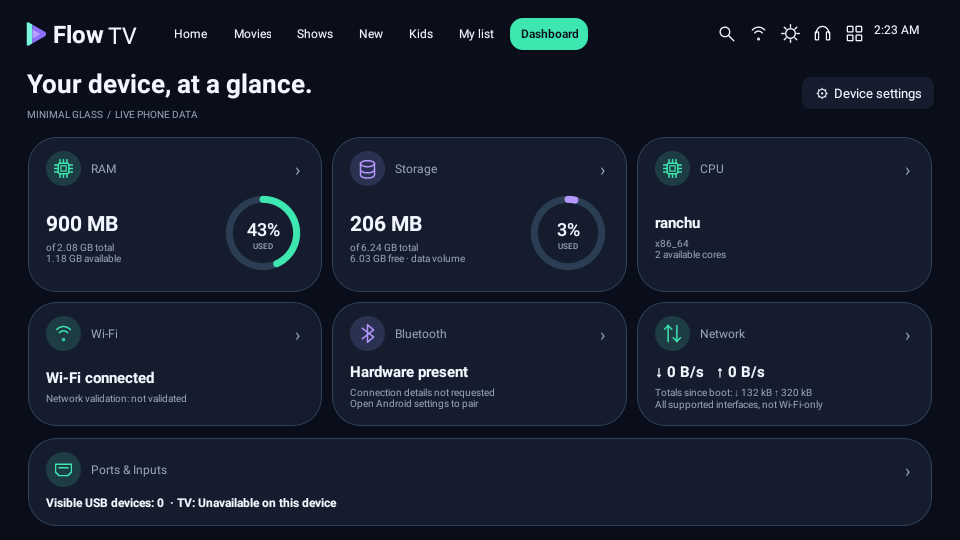
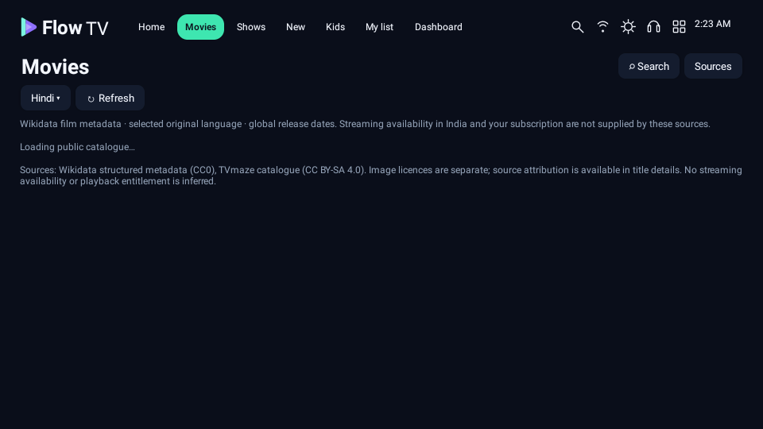

# Flow TV 0.4.2

[Download debug APK](Flow-TV-v0.4.2-debug.apk) · [Actual APK screenshots](screenshots-v0.4.2) · [Source](../app/src) · [Validation](../VALIDATION.md) · [Supplied-code review](../IMPORT_REVIEW.md)

Android 8+. VersionCode 6, target SDK 35. Install over 0.4.1 when the signing certificate matches; the certificate used here is unchanged. Keep Play Protect enabled. Acceptance on a physical phone remains unverified.

## Implemented

- Supplied public-catalogue approach adapted to the existing native Java application: Wikidata film metadata, TVmaze series directory/search and dated episode schedule; connected Home/Movies/Shows/New/Kids, native title search and local My List.
- Honest source/date/language attribution, source information links and explicitly app-only provider fallback. No unsupported Watch action or private-account import.
- Error/loading states, bounded caching, stale-data labels, source networking controls and metadata/artwork attribution.
- The supplied Minimal Glass palette with rounded Dashboard cards, actual RAM/storage rings and traffic rates derived from real counters.
- Preserved installed app icons/launches/reordering, touch/D-pad/on-screen remote, compact settings and functional local dot-matrix audio.

## Verification boundary

**This environment blocks TVmaze and Wikidata through its network policy. No successful live catalogue connection is claimed.** Instrumentation fixtures test parsing and control behavior; they do not establish live source content, coverage or provider access. Final screenshots contain no injected successful catalogue rows. Test actual source retrieval on the phone’s own network. See [source limits](../CONNECTED_APPS.md).

Prime Video, JioHotstar and Airtel Xstream logins remain private. No verified India streaming-availability feed, subscription detection, provider-added history, exact-title link, certified kids rating or YouTube playback control is implemented. Notification-listener access remains removed. Actual realme Picture Off/remote behavior and YouTube screen-off playback remain unverified.

| Rounded phone-data Dashboard | Actual catalogue/error state |
| --- | --- |
|  |  |

[Checksums](SHA256SUMS.txt) · [Permission audit](validation/permission-audit.json) · [Installation warning report](../INSTALLATION.md)

Versioned older APKs/screenshots remain historical. `Flow-TV-debug.apk` aliases this release.

## Supplied ZIP review and separate prototype

The supplied `FlowTV.zip` is a smaller Kotlin launcher, separate from the full app above. Its corrected phone-test build installs alongside Flow TV and does not include Dashboard or audio. [Review/comparison](../reviews/FlowTV-zip-review.md) · [Prototype APK](Flow-TV-Prototype-v0.1.1-debug.apk) · [Prototype source ZIP](Flow-TV-Prototype-v0.1.1-source.zip).
