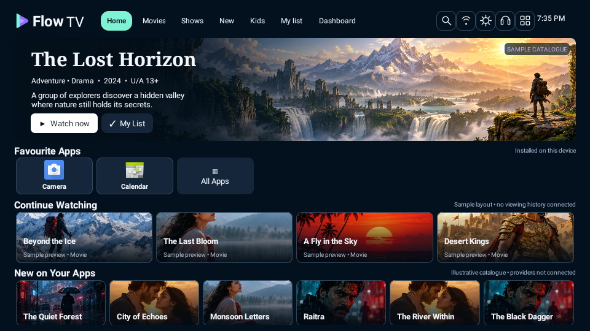
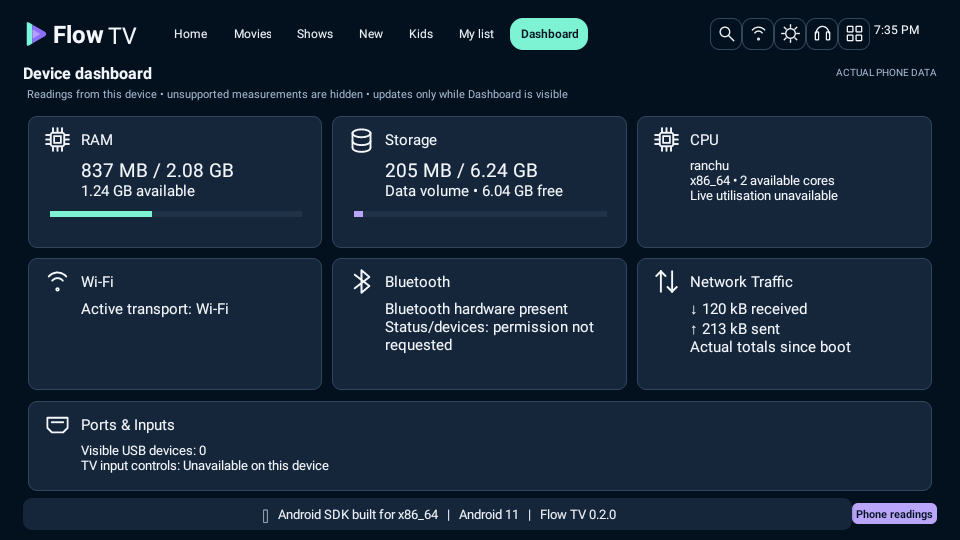
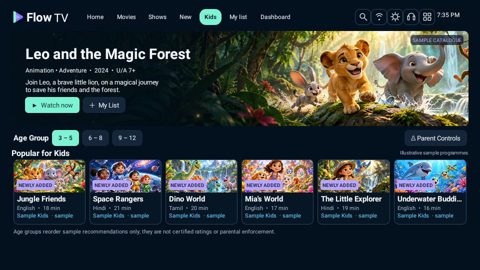
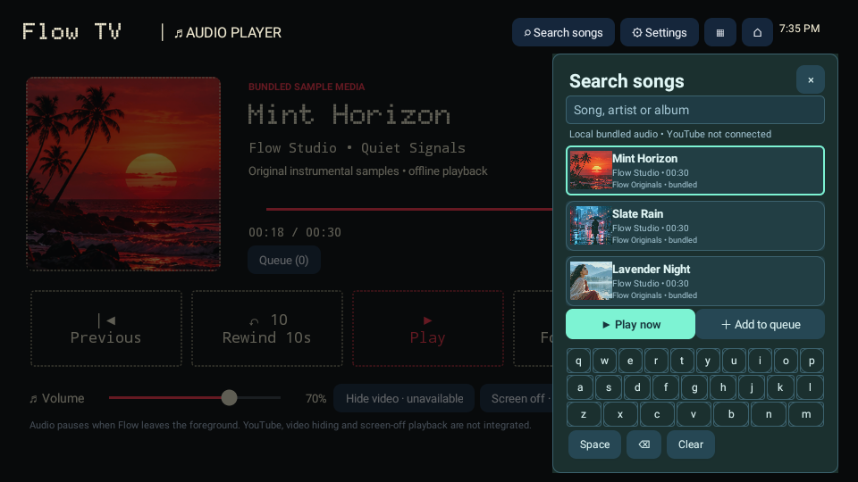

# Flow TV 0.2.0 — reference UI rebuild

[Download the updated Android APK](Flow-TV-v0.2.0-debug.apk)

Install over v0.1.0 to retain local favourites and watchlist. Android 8+ is required. Application ID and development signing certificate are unchanged. `Flow-TV-debug.apk` is an alias for the latest build.

This version replaces the earlier basic interface with native layouts based on the supplied references: illustrated Home and Kids banners, compact catalogue rows, poster grids, actual installed-app icons, native hardware Dashboard, compact side panels, and dot-matrix audio/search.

These are **actual screenshots of the running APK**, not UI concept images:

| Home | Dashboard |
| --- | --- |
|  |  |

| Kids | Audio search |
| --- | --- |
|  |  |

[All captured screens](screenshots) · [Source](../app/src) · [Validation](../VALIDATION.md) · [SHA-256 checksums](SHA256SUMS.txt)

Artwork, provider labels and catalogue content are illustrative. Hardware readings and app icons come from the installed device. Unsupported readings are hidden or marked unavailable. No YouTube/live catalogue, voice, HDMI switching, parental enforcement or screen-off playback is claimed. Physical realme TV testing remains pending.
