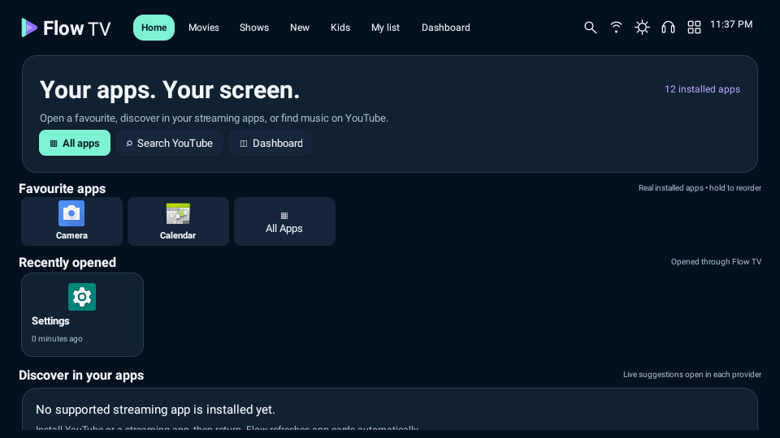
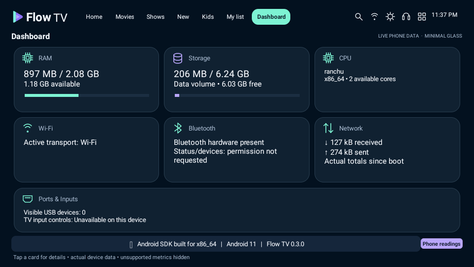
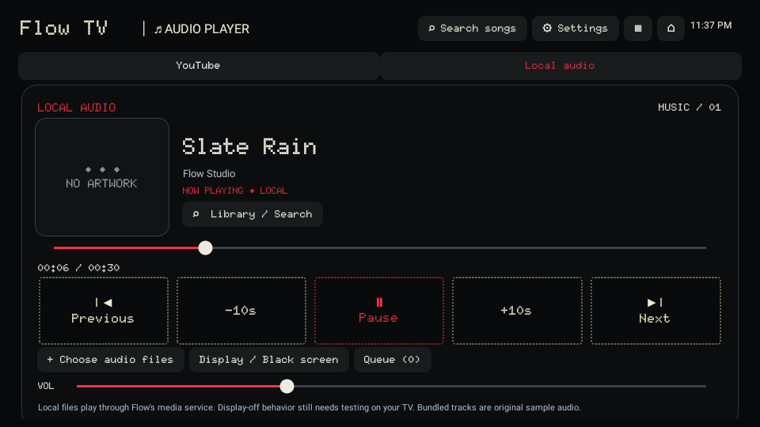
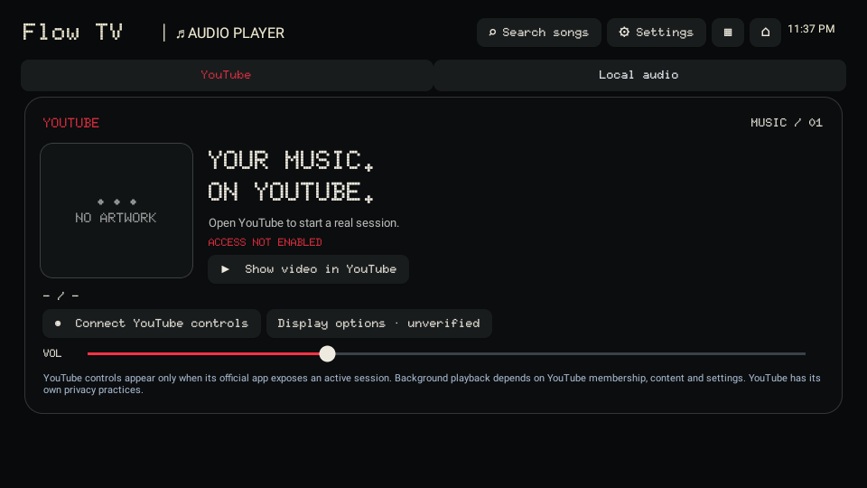

# Flow TV 0.3.0 — device cards and listening

[Download the Android debug APK](Flow-TV-v0.3.0-debug.apk) · [Source](../app/src) · [Validation](../VALIDATION.md) · [YouTube feasibility](../YOUTUBE_FEASIBILITY.md)

Android 8+. Install over the previous Flow TV APK to keep local favourites/lists. Same app ID and debug signing certificate. `Flow-TV-debug.apk` is the latest-build alias; use the versioned download to avoid confusing it with a cached older file.

## Implemented

- Real installed-app cards, app launch, favourite reordering and locally recorded recently opened apps. Default movie/provider pages contain no invented catalogue results.
- Minimal Glass device Dashboard with actual readings and hidden unsupported metrics.
- Official YouTube search and playback hand-off. Optional, explicitly granted Android notification access reads exposed YouTube media-session metadata/actions; it does not grant membership or guarantee background playback.
- Black/white/red dot-matrix audio UI. Local audio is fully playable: original bundled tracks, user-selected files, metadata/artwork where present, play/pause, seek, previous/next, ±10 seconds, volume, real queue and search.
- Foreground local-audio service and media notification. A separately labelled local Black screen keeps the display on and has no widgets; touch/Back/remote/keyboard restores the UI.
- Touch, keyboard/D-pad, mobile landscape preview and optional on-screen remote. Compact right-side settings.

## Not claimed as working

YouTube Hide Video and Screen Off are **unverified and unavailable in Flow**. There is no stream extraction, hidden API player, Premium bypass or simulated successful YouTube playback. Playback remains controlled by the official source and its membership/content/device rules. YouTube documents background play as mobile-only, so Flow disables this integration on Android TV. No configured in-app catalogue API or live recommendation feed exists; providers show their real suggestions within their own apps.

The realme RMV2004's picture-off command, continued audio and remote wake behavior need physical-TV verification. Standby can stop playback. Black pixels do not power off a panel/backlight. YouTube has its own privacy practices.

[Official documentation was reviewed](../YOUTUBE_FEASIBILITY.md), including the mobile-only background-play limitation, official listening modes and Android session permissions. Physical-device verification remains separate.

## Actual running APK captures

| Device Home | Minimal Glass Dashboard |
| --- | --- |
|  |  |

| Local dot-matrix player | YouTube connection state |
| --- | --- |
|  |  |

[All v0.3 captures](screenshots-v0.3) · [Checksums](SHA256SUMS.txt)

Captures show the emulator's actual apps/readings. The saved video link and own audio import are test inputs, not fetched results. Earlier v0.2 design-preview captures remain in `screenshots/` for history; they are not live catalogue evidence.
