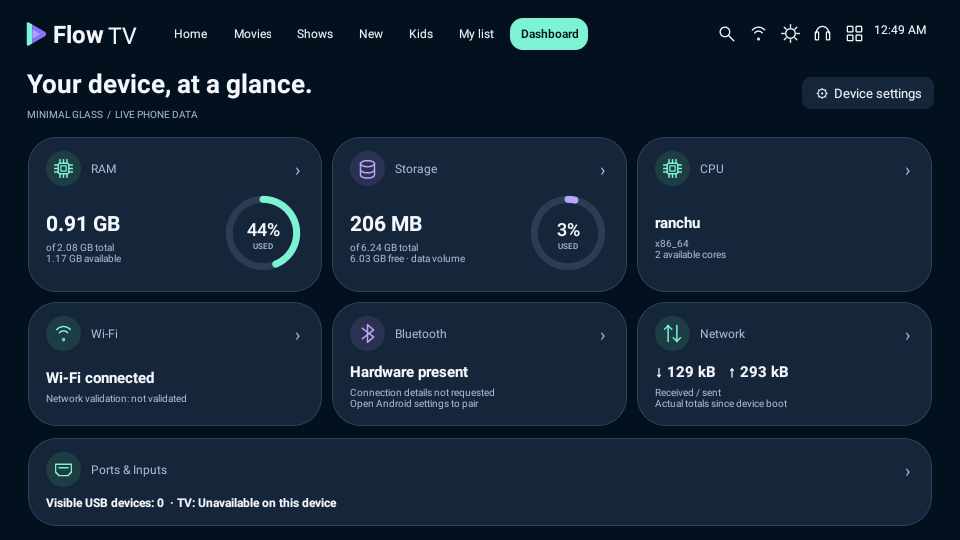
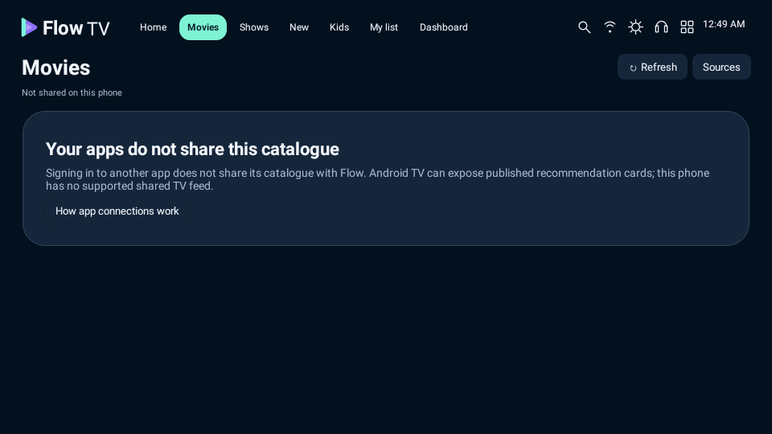

# Flow TV 0.4.1

[Download debug APK](Flow-TV-v0.4.1-debug.apk) · [Actual screenshots](screenshots-v0.4.1) · [Source](../app/src) · [App-source limits](../CONNECTED_APPS.md) · [Validation](../VALIDATION.md)

Android 8+. Install over the earlier version; package and signing certificate are unchanged. Use this versioned file to avoid a cached older download. `Flow-TV-debug.apk` aliases this build.

## Installation update

After a reported Play Protect installation block, the notification-listener service and all external media-session access were removed. Flow no longer requests notification access or offers YouTube controls. YouTube search/open stays in the official app; local dot-matrix playback remains functional. **Play Protect acceptance is unverified; keep it enabled.** See [installation analysis](../INSTALLATION.md).

## Preserved

- Rounded Minimal Glass widgets: larger radii, circular RAM/storage gauges, icon wells and matching focus outlines. All measurements are actual installed-device readings.
- Movies, Shows, New and Kids no longer reuse installed-provider/app lists or generic trailer searches. Each uses only matching programme records shared through Android TV, where the OS permits access.
- New requires the source's explicit NEW flag. Kids requires published family/kids metadata. Unavailable data is explained rather than filled with invented titles.
- Shared-title My list and global search remain separate from saved YouTube links. The public fictional sample-mode switch was removed and its previous preference is cleared during upgrade.
- Local dot-matrix audio, installed apps, remote/touch controls and compact settings remain.

## Critical limit

**Logging in to another app does not give Flow that app's private catalogue or session.** Android TV may expose a limited shared feed, which some firmware restricts. Phones normally do not expose it. Actual logged-in TV feed access is unverified here; no full Netflix/Prime/Hotstar catalogue integration is claimed. The user is testing on a phone signed into Prime Video, JioHotstar and Airtel Xstream; those private mobile catalogues are not exposed to Flow.

| Actual rounded Dashboard | Honest phone Movies state |
| --- | --- |
|  |  |

[Checksums](SHA256SUMS.txt). Historical screenshots in other folders belong to older versions and do not establish live provider availability. YouTube Hide Video, YouTube Screen Off and realme Picture Off remain unverified/unavailable in Flow as described in the feasibility report.
