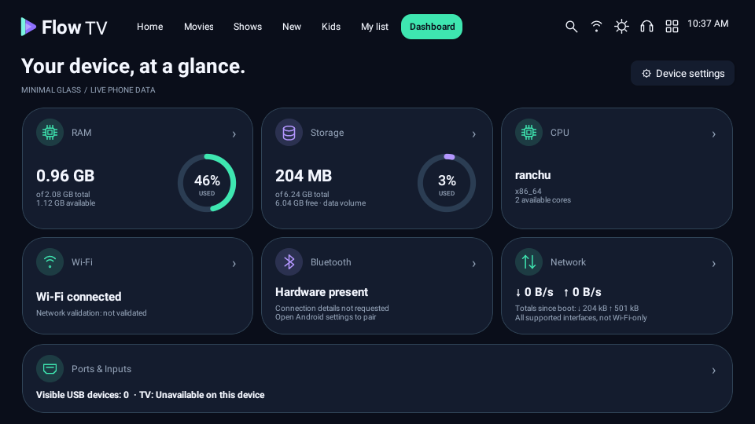
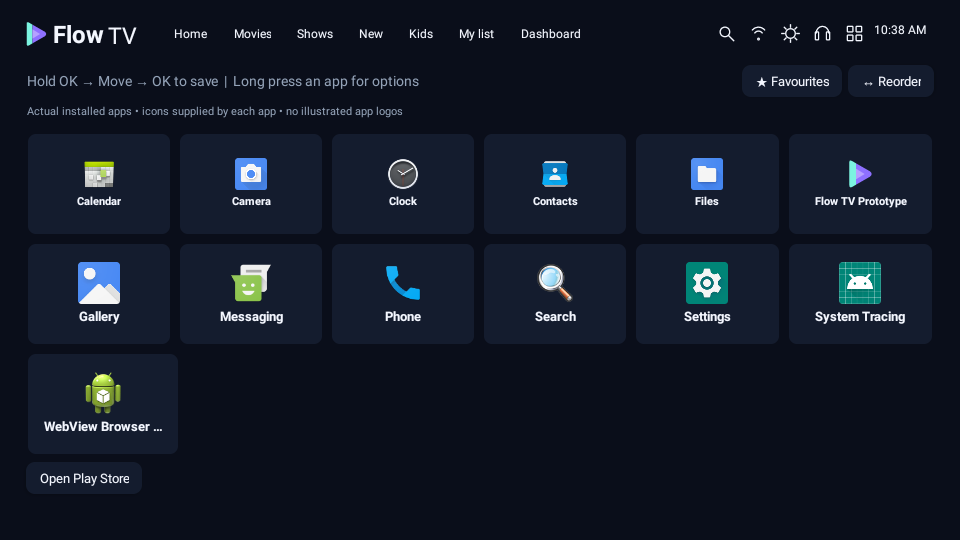
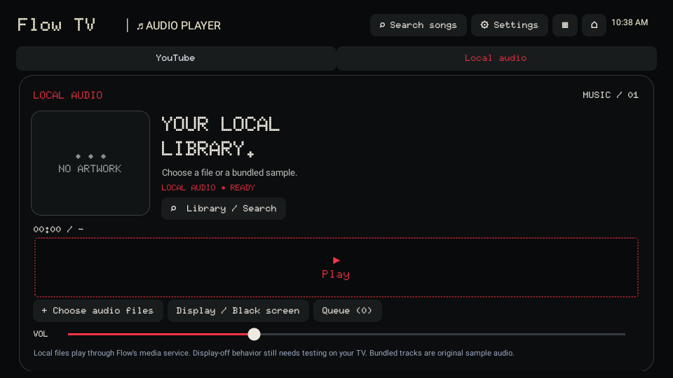
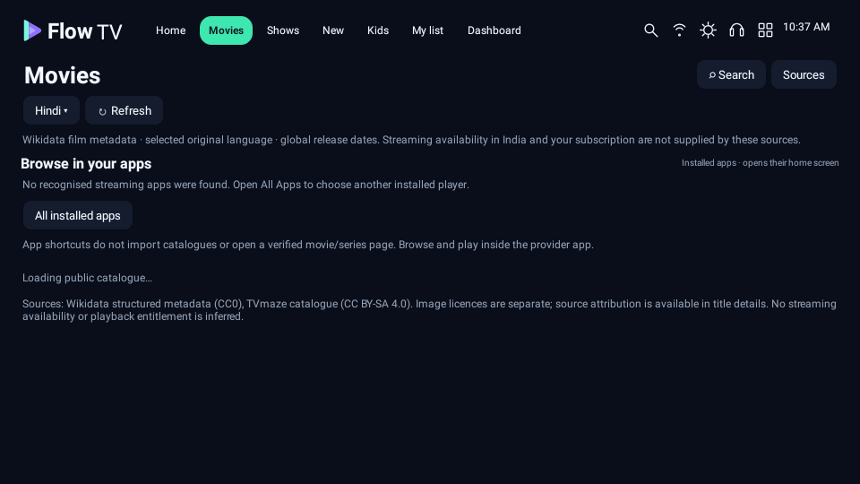

# Actual Flow TV 0.5.0 APK captures

17 captures from the installed full app on an Android 11 phone emulator, after clearing test data. Source networking is enabled; no successful catalogue fixtures or fictional movie rows are injected. Public source requests may be loading or unavailable in this managed network. Device readings and installed icons are actual emulator data.

| Minimal Glass Dashboard | Actual installed apps |
| --- | --- |
|  |  |

| Dot-matrix local audio | Movie catalogue/source state |
| --- | --- |
|  |  |

[Portrait Dashboard](15-portrait-dashboard.png) · [On-screen remote](14-tv-preview-remote.png) · [Settings drawer](09-settings.png) · [YouTube limits](13-youtube.png).

The bundled tracks are real original sample audio. These captures do not prove YouTube playback, physical TV support, private provider catalogue access or Play Protect acceptance. [Validation](../../VALIDATION.md).
